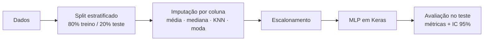

# ann-classification-machine-learning

**Classificadores MLP em Keras para dados tabulares ruidosos (binário) e para uma base sintética de 15 classes, com pipeline sem vazamento de dados e comparação sistemática de variantes.**


Projeto da disciplina de Inteligência Artificial (UDESC, Joinville). Reúne dois estudos com redes neurais *Multilayer Perceptron* (MLP) e um artigo no formato SBC com a metodologia completa, as métricas e os gráficos.

> 📄 **Quer os detalhes?** Leia o artigo em [`docs/relatorio.pdf`](docs/relatorio.pdf). Este README é só o resumo de como usar e de como funciona.

---

## Destaques

- **Pipeline sem vazamento de dados:** a separação treino/teste vem *antes* da imputação e do escalonamento; tudo é ajustado só no treino (`fit`) e apenas aplicado ao teste (`transform`).
- **Dados reais e sujos:** a base binária tem de 4% a 15% de valores faltantes por coluna e *outliers* nos sensores. A imputação é escolhida por coluna (média, mediana, KNN ou moda) com `ColumnTransformer`.
- **Comparação de quatro variantes** do modelo binário (arquitetura, codificação categórica, escalonador), analisadas com intervalos de confiança em vez de só olhar a acurácia.

## Resultados em resumo

| Tarefa | Modelo | Acurácia no teste |
|---|---|---|
| Binária (10 000 amostras) | MLP 16–8–1, L2, *early stopping*, *one-hot encoding* (v1.2) | **81,00%** (IC 95%: 79,8–83,2) |
| 15 classes (600 amostras) | MLP 8–15, softmax | **100%** (120/120; piso de ~97% com 95% de confiança) |

Na tarefa binária, quatro variantes ficaram entre 80,55% e 81,60%, uma diferença menor que a incerteza amostral do teste:

| Versão | Mudança em relação à anterior | Acurácia |
|---|---|---|
| 1.1 | Rede compacta 16–8–1, L2 (0,001), *early stopping*, `StandardScaler`, codificação ordinal | 81,60% |
| 1.2 | Codificação *one-hot* de `environment` | 81,00% |
| 1.3 | `RobustScaler` no lugar do `StandardScaler` | 80,55% |
| 1.4 | Rede 64–32–16 com BatchNorm, *Dropout* 0,2 e ativação *swish* (sem L2) | 81,30% |

A leitura do artigo é que mais capacidade e outro pré-processamento não ajudaram, o que é consistente com um limite imposto pela informação nos atributos. É uma hipótese, não uma demonstração. As métricas completas (sensibilidade, especificidade, precisão, VPN, F1), as curvas de aprendizado e as matrizes de confusão estão no artigo.

## Como funciona



**Base binária** (`base_classificacao_binaria.csv`): dez atributos numéricos de sensores/medidas, um atributo categórico (`environment`) e o rótulo `target`. O `sample_id` é descartado.

**Base sintética** (`base-sintetica.txt`): 600 amostras, dois atributos contínuos e 15 classes balanceadas (40 por classe).

| | Binária (v1.1) | Sintética |
|---|---|---|
| Camadas ocultas | 16 e 8 neurônios, ReLU | 8 neurônios, ReLU |
| Saída | 1 neurônio, sigmoide | 15 neurônios, softmax |
| Perda | entropia cruzada binária | entropia cruzada categórica esparsa |
| Regularização | L2 (0,001) + *early stopping* (paciência 15) | nenhuma |
| Escalonador | `StandardScaler` | `StandardScaler` |
| Otimizador | Adam | Adam (taxa 0,01) |
| Lote / épocas | 64 / até 100 | 16 / 100 |

## Estrutura do repositório

```
ann-classification-machine-learning/
├── notebooks/
│   ├── classificacao_binaria.ipynb   # tarefa binária: EDA, pré-processamento, variantes 1.1–1.4
│   └── base_sintetica.ipynb          # tarefa de 15 classes
├── data/                             # coloque aqui os arquivos de dados (veja abaixo)
├── docs/
│   └── relatorio.pdf                 # artigo completo (formato SBC)
├── requirements.txt
└── README.md
```

## Como instalar e executar

```bash
git clone https://github.com/lucasomac0/ann-classification-machine-learning.git
cd ann-classification-machine-learning

python -m venv .venv
source .venv/bin/activate        # no Windows: .venv\Scripts\activate
pip install -r requirements.txt

jupyter notebook notebooks/
```

Abra `classificacao_binaria.ipynb` ou `base_sintetica.ipynb` e execute as células em ordem. Cada notebook segue as mesmas etapas do artigo (entendimento do problema, análise exploratória, tratamento de faltantes, escalonamento, separação, construção da rede, treino, validação e avaliação).

**Dados:** os notebooks esperam os arquivos `base_classificacao_binaria.csv` e `base-sintetica.txt` na pasta `data/`. Se os caminhos no seu ambiente forem diferentes, ajuste a célula de leitura no início de cada notebook.

**Reprodutibilidade:** a divisão treino/teste usa `random_state=42`. A inicialização dos pesos da rede não tem semente fixa, então os números podem variar um pouco entre execuções.

## Limitações e próximos passos

- Cada variante foi treinada uma vez e avaliada em uma única partição de teste; validação cruzada e várias sementes permitiriam testes pareados.
- A rede profunda (v1.4) alterou vários fatores de uma vez; alterar um por vez isolaria o efeito de cada componente.
- Não foram comparados modelos de referência para dados tabulares (por exemplo, *gradient boosting*), que testariam a hipótese do limite dos dados.
- Na base sintética, o teste tem só 120 amostras (8 por classe).

## Artigo

O trabalho está descrito em [`docs/relatorio.pdf`](docs/relatorio.pdf): *Classificação com Redes Neurais Artificiais: Um Estudo Comparativo em Dados Tabulares Binários com Valores Faltantes e em uma Base Sintética de 15 Classes*.

## Autor

**Lucas Macedo**, Ciência da Computação na UDESC (Joinville).
[LinkedIn](https://www.linkedin.com/in/lucas-oliveira-macedo) · [Hugging Face](https://huggingface.co/lucasomac)

## Licença

MIT. Veja o arquivo `LICENSE`.
